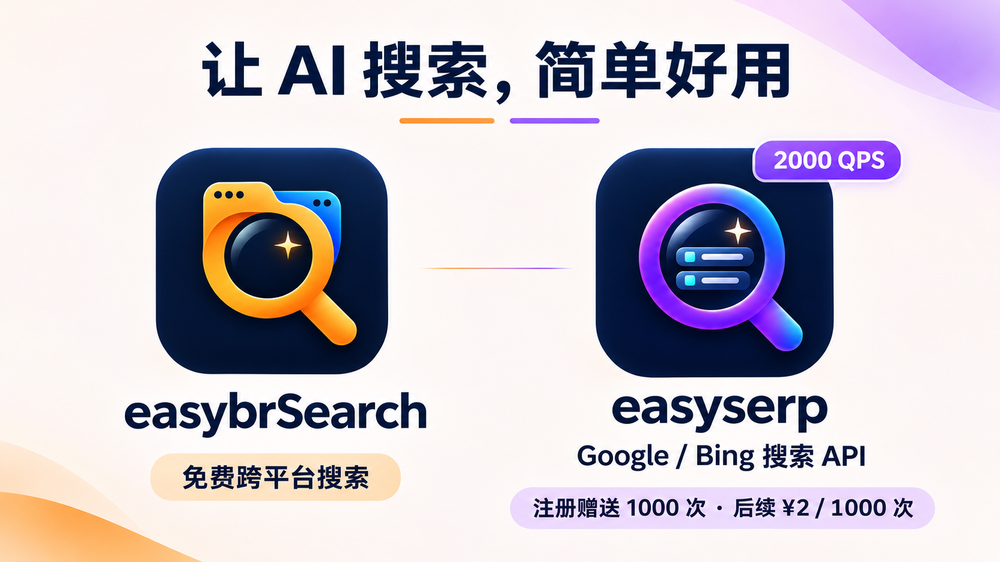

# easyserp




Google and Bing search API for structured web results in AI agent and automation workflows. It supports **2,000 QPS**. Registration at the [console](https://serp.skyvora.cc) includes a **one-time gift of 1,000 searches**, followed by **¥2 per 1,000 searches**. The gift is not a monthly allowance.

[GitHub](https://github.com/aiispower/easyserp) · [Gitee](https://gitee.com/xxjrq/easyserp) · [1.0.0 downloads](https://github.com/aiispower/easyserp/releases/tag/v1.0.0) · [Free easybrSearch](https://github.com/aiispower/easybrSearch)

## Claude Code

Install both related Skills from the public marketplace:

```sh
claude plugin marketplace add aiispower/easyserp
claude plugin install easyserp@easy-search-tools
claude plugin install easybr-search@easy-search-tools
```

## Claude Desktop / MCP

Download `easyserp-1.0.0.mcpb` from the [1.0.0 release](https://github.com/aiispower/easyserp/releases/tag/v1.0.0), import it in an MCPB-compatible client, and configure your API key. Runtime dependencies are bundled; Node.js 20+ is required. See the [MCPB guide](docs/MCPB.md).

Version `1.0.0` is active in the [official MCP Registry](https://registry.modelcontextprotocol.io/v0.1/servers/io.github.aiispower%2Feasyserp/versions/1.0.0).

## Get started

Register in the console and create an API key. Keep it in an environment variable; do not paste it into chat or command arguments:

```sh
export EASYSERP_API_KEY='your-key'
```

Install `skills/easyserp/` from this repository as an Agent Skill, then ask your agent to use it. The Skill runs the bundled CLI, so users do not need to write integration code:

```text
Use easyserp to search Google and Bing for sources about [topic], compare the results, and keep the source links.
```

You can also run the CLI from the source checkout:

```sh
node src/cli.mjs search "solar power" --engine google --region US --format markdown
node src/cli.mjs batch ./queries.json --concurrency 4
node src/cli.mjs request REQUEST_ID
```

Use `request` to check a pending queued/running request. If the network outcome is unknown, retain its request ID and idempotency key and follow the recovery guide; do not create a new key and submit it again.

## Choose the right tool

- **easyserp** is for repeatable, structured or programmatic Google/Bing web search. CLI, MCP, and API use the same metered service.
- **[easybrSearch](https://github.com/aiispower/easybrSearch)** is a free browser research Skill/CLI. It reuses a connected browser to search websites, social/media platforms, and code projects, then reads selected pages. Sources: [GitHub](https://github.com/aiispower/easybrSearch) and [Gitee](https://gitee.com/xxjrq/easybrSearch). It does not require an easyserp API key or include easyserp API credits.

Use them together when useful: explore and read across sites with easybrSearch, then use easyserp when a workflow needs programmatic Google/Bing results. For content planning, production, and multi-platform publishing based on research, see the optional [aimeGeo](https://geo.aimmme.com/) workflows.

## Developer integrations

HTTP API, MCP stdio, local setup, and SDK instructions are in the [integration guide](docs/INTEGRATIONS.md); see the [API reference](docs/API.md) for fields and recovery behavior. The SDK is an optional developer integration; most users should start with the Skill or CLI.

The open-source client, CLI, MCP adapter, and Skill use the MIT License. The hosted search service is metered. See [channel and launch materials](docs/MARKETPLACE.md); listing status is updated only after an actual submission.

中文：[README.md](README.md).
